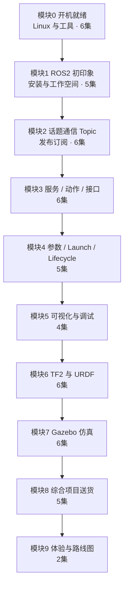

# ROS2 保姆级课程（Python 入门版）· 课程大纲

> 课程名称：ROS2 保姆级课程（Python入门版） 
> 定位：面向**零基础小白**的 ROS2 保姆级入门视频课
> 形态：按集规划（每集含目标、演示、坑点、预期输出、小作业） 
> 范围：环境 → 通信 → 工具链 → 建模仿真 → 综合项目；
> 技术栈：WSL2 + Ubuntu 24.04 LTS · **ROS2 Jazzy Jalisco（LTS）**· Python 3.12 / rclpy · RViz2 · Gazebo Harmonic


## 〇、全局约定（版本锁定）

| 项目         | 锁定值                                             | 说明                       |
| ------------ | -------------------------------------------------- | -------------------------- |
| 操作系统     | Ubuntu 24.04 LTS（Noble）                          | 主路径 WSL2；代号 `noble`  |
| ROS 发行版   | ROS2 **Jazzy Jalisco**（LTS，支持至 2029-05）      | 全课只用 Jazzy             |
| apt 包名前缀 | `ros-jazzy-*`                                      | 例：`ros-jazzy-desktop`    |
| Python       | **3.12**（Ubuntu 24.04 自带）                      | 只用 `python3`             |
| 构建         | `colcon` + **`ament_python`**                      | 不用 catkin / ament_tools  |
| CLI          | `ros2cli`                                          | 不用 `rostopic` / `rosrun` |
| 仿真         | **Gazebo Harmonic** + `ros_gz`（`gz sim`）         | 禁用 Classic / `gazebo`    |
| bag          | `ros2 bag`（rosbag2）                              | 非 `rosbag`                |
| 项目契约     | `cmd_vel` / `odom` / `scan` / `map→odom→base_link` | 见系列 `CONTRACT.md`       |

---

## 一、课程定位

学完本课，我们能够独立完成：

1. 搭好 WSL2 + Ubuntu 24.04 + ROS2 Jazzy 环境，读懂并跑通任意入门级 ROS2 工程；
2. 熟练使用 Topic / Service / Action / Parameter；
3. 用 Python 3.12 + rclpy 写出可编译、可 launch、可调试的节点包；
4. 用 URDF/Xacro 描述差速小车，在 Gazebo Harmonic 跑起来并键盘遥控；
5. 看懂 TF、日志、bag、RQT，能排查"节点不说话 / 说话听不懂"；
6. 完成"仿真小车送货"综合项目，并**看见** SLAM/Nav2 效果。

**适合人群**：零基础、算法验证、仿真开发、上位机逻辑、快速原型。

---

## 二、教学原则

| 原则 | 落地做法 |
| ---- | -------- |
| 先看见效果，再讲原理 | 每集开头 30 秒最终效果 |
| 生活化比喻优先 | Topic=广播，Service=打电话，Action=点外卖，TF=图例 |
| 一条主路径 | WSL2 + Ubuntu 24.04；VS Code；Python 3.12 |
| 踩坑前置 | 每集"常见坑"贴报错原文 |
| 可跟随操作 | 命令/代码/路径编号，1:1 可复现 |
| **预期可见** | 每步写明"跑完应看到什么" |
| 小步验收 | 每集 5 分钟内小作业 |
| 版本钉死 | 安装命令带 `ros-jazzy-*`；文档切到 Jazzy |

### 每集标准结构

1. **目标**（15s）　
2. **演示**（30–60s）　
3. **讲解+跟做**（主时长）　 
4. **常见坑**（1–2min）　
5. **预期输出**（30s）　
6. **小作业+预告**（30s）

单集时长：8–15 分钟（环境安装类 ≤ 20 分钟）。

---

## 三、课程地图



**能力主线**：环境与终端 → 节点/话题 → 服务与动作 → 启动组织 → 调试 → 坐标与模型 → 仿真 → 综合项目 → 看见进阶。

---

## 四、模块与分集大纲

### 模块 0 · 开机就绪：开发环境与 Linux 急救包（6 集）

> 目标：把"连 Ubuntu 都没装过"的人带到能流畅使用终端和 VS Code。 
> 衔接：本模块不出现 ROS 概念。

| 集 | 标题 | 本集目标 | 关键演示 | 常见坑 |
| -- | ---- | -------- | -------- | ------ |
| 0.1 | 课程导学：学完你能做出什么 | 建立预期 | 最终项目：Gazebo 遥控小车送货 | 把 ROS2 当成装一个软件 |
| 0.2 | 安装 Ubuntu 24.04（WSL2） | 装好环境 | `wsl --install -d Ubuntu-24.04`；`.wslconfig`；WSLg 验证 | WSL1/2 搞混；WSLg 黑窗 |
| 0.3 | Linux 命令行急救包 | 会用终端 | 目录、权限、进程、管道、sudo | `/` 与 `~`；sudo 乱用 |
| 0.4 | apt、软件源与国内镜像 | 安装不卡 | 换 noble 源、`apt update/install` | 源与 24.04 不匹配 |
| 0.5 | VS Code + WSL + 中文 | 舒服写代码 | Windows VS Code + WSL 扩展；Python 3.12 | 没走 WSL 远程 |
| 0.6 | Python 3.12 快速上手 | 会写类与异常 | `MiniRobot` 小脚本 | 缩进；venv 混淆 |

**小作业**：`~/dev/practice/` 下用 VS Code 写打印当前时间的脚本并跑通。 
**预期输出示例（0.2）**：`wsl -l -v` 显示 Ubuntu-24.04 / VERSION 2；`xeyes` 弹窗。

---

### 模块 1 · ROS2 初印象：从安装到第一次编译（5 集）

> 衔接：依赖模块 0；结束时已有第一个 ROS2 包。

| 集 | 标题 | 本集目标 | 关键演示 | 常见坑 |
| -- | ---- | -------- | -------- | ------ |
| 1.1 | ROS 为什么长这样 | 理解解决什么问题 | 通信/工具/生态一张图 | 当成实时操作系统 |
| 1.2 | 安装 ROS2 Jazzy | 装好并能 source | locale → 源 → `ros-jazzy-desktop` → `ros2 doctor` | 忘记 source；装成 Humble |
| 1.3 | turtlesim 与 ros2 CLI | 会用核心命令 | `ros2 run/node/topic/list` | 只抄命令不理解 |
| 1.4 | 工作空间与包 | 搞清目录约定 | `ament_python` 建包；`package.xml` / `setup.py` | 建错目录；包名非法 |
| 1.5 | colcon 编译与排查 | 独立编译闭环 | `colcon build --symlink-install` → source → 跑节点 | 未 source install |

**Jazzy 注意**：文档停在 Jazzy 页；`sudo apt install ros-jazzy-desktop python3-colcon-common-extensions python3-rosdep python3-vcstool`。 
**小作业**：包 `my_first_pkg`，节点打印 Hello ROS2，任意终端可 `ros2 run`。

---

### 模块 2 · 话题通信 Topic（6 集）

> 复用约定：此处 `geometry_msgs/Twist` 就是系列契约的 `/cmd_vel`，后续不改名。

| 集 | 标题 | 本集目标 | 关键演示 | 常见坑 |
| -- | ---- | -------- | -------- | ------ |
| 2.1 | 通信总览：Topic/Service/Action | 建立三种直觉 | 比喻对照表 | 用 Service 传高频数据 |
| 2.2 | 节点 Node | 理解节点与可执行 | 命名、命名空间、remap | 一包=一节点 |
| 2.3 | 话题与消息类型 | 看懂 msg | `topic info/echo/hz`；std/geometry/sensor_msgs | 类型不匹配没数据 |
| 2.4 | 手写 Publisher（Python 3.12） | 能发布 | Twist 速度指令 | timer 与 spin |
| 2.5 | 手写 Subscriber（Python 3.12） | 能订阅处理 | 回调处理消息 | 回调阻塞；QoS 不匹配 |
| 2.6 | QoS 与 Topic 坑合集 | 能排查通信 | QoS 兼容、队列、调试 | reliable/best_effort 混用 |

**小作业**：一对节点发布/订阅 `/turtle_cmd`，`ros2 topic hz` 验证频率。

---

### 模块 3 · 服务、动作与自定义接口（6 集）

> 自定义接口放在手写 Server/Client 之前，解决"先用到再学"。

| 集 | 标题 | 本集目标 | 关键演示 | 常见坑 |
| -- | ---- | -------- | -------- | ------ |
| 3.1 | Service：一问一答 | 理解请求/响应 | turtlesim `/spawn` `/set_pen` | 阻塞调用卡死 |
| 3.2 | 自定义 .msg/.srv/.action | 会建接口包 | `ament_cmake --interface-only`；三种文件 | 没编译就 import |
| 3.3 | Service Server/Client | 能实现调用 | 自定义 srv + 同步/异步 | 未 source 新 install |
| 3.4 | Action：长时任务 | 理解 goal/feedback/result | 进度反馈与取消 | 当成更快的 Service |
| 3.5 | Action Server/Client | 能实现反馈任务 | 前进 N 米并汇报 | 忘记取消处理 |
| 3.6 | 三种通信怎么选 | 能做设计决策 | 决策表 + 综合案例 | 全局话题 vs 私有服务 |

**深度**：3.2 讲清 `package.xml` depend 与 `CMakeLists` `rosidl_generate_interfaces`。 
**小作业**：查询状态 Service + 前进 N 米 Action。

---

### 模块 4 · 参数、Launch、Lifecycle 与工程化（5 集）

| 集 | 标题 | 本集目标 | 关键演示 | 常见坑 |
| -- | ---- | -------- | -------- | ------ |
| 4.1 | 参数 Parameter | 声明/读取/动态改 | `ros2 param`；YAML | 声明与读取不一致 |
| 4.2 | Launch 一键多节点 | 会组织启动 | Python launch + remap/参数 | 路径写死；没装入 share |
| 4.3 | 多节点小系统串联 | 搭最小软件栈 | 感知→决策→执行 | 无统一命名空间 |
| 4.4 | Lifecycle（了解为主） | 看懂状态机 | configure/activate | 状态没 activate |
| 4.5 | 项目结构与代码规范 | 工程收干净 | 目录、README、rosdep | 依赖靠记忆 |

**小作业**：launch 同时起 pub/sub，YAML 加载频率与话题名。

---

### 模块 5 · 可视化与调试工具（4 集）

| 集 | 标题 | 本集目标 | 关键演示 | 常见坑 |
| -- | ---- | -------- | -------- | ------ |
| 5.1 | RQT 工具箱 | 图形化看系统 | graph/console/plot/topic | 只看 graph |
| 5.2 | ros2 bag 录放 | 会保存复现 | `ros2 bag record/play/info` | 用成 ROS1 rosbag |
| 5.3 | 日志与可观测性 | 会写有效日志 | logger 级别命名 | 用 print |
| 5.4 | 调试方法论 | 独立定位问题 | 不说话/说错话/说晚了 | 不先看 node list |

**小作业**：录 bag 回放，rqt_plot 画曲线。

---

### 模块 6 · TF2 与机器人建模 URDF（6 集）

| 集 | 标题 | 本集目标 | 关键演示 | 常见坑 |
| -- | ---- | -------- | -------- | ------ |
| 6.1 | 坐标系与 TF | 理解 frame/变换 | map/odom/base_link | 当成绝对坐标 |
| 6.2 | TF2 广播与监听 | 会发布查询 | 静态/动态 TF；view_frames | 时间戳 extrapolation |
| 6.3 | URDF 初识 | 看懂 link/joint | 小车底盘 | 轴向/单位错 |
| 6.4 | Xacro 参数化 | 会复用建模 | 宏、属性、包含 | 没展开给 RViz |
| 6.5 | RViz2 检查模型 | 会自检 | RobotModel+TF | fixed frame 选错 |
| 6.6 | 建模坑合集 | 独立修 URDF | visual/collision/inertial | 惯性乱填爆炸 |

**小作业**：Xacro 双驱轮+支撑轮小车，RViz2 正确显示。

---

### 模块 7 · Gazebo Harmonic 仿真：让小车动起来（6 集）

> 控制路径：7.3 diff_drive 插件先跑通；7.5 了解 ros2_control；7.6 用插件路径验收。 
> 只用 Harmonic + `ros-jazzy-ros-gz*`。

| 集 | 标题 | 本集目标 | 关键演示 | 常见坑 |
| -- | ---- | -------- | -------- | ------ |
| 7.1 | Gazebo 安装与界面 | 会启动世界 | `ros-jazzy-ros-gz`；空世界 | Classic 混淆；WSLg 黑屏 |
| 7.2 | URDF 拉进仿真 | 模型出现且稳定 | `ros_gz_sim create` | 缺 plugin；飞走 |
| 7.3 | 差速小车与 cmd_vel | 可驱动底盘 | diff_drive + Twist | 轮参数错 |
| 7.4 | 传感器：相机与雷达 | 会接传感器话题 | Image/LaserScan/Imu | frame 与 TF 不一致 |
| 7.5 | ros2_control（了解） | 理解分层 | 控制器 spawn | 未 spawn 就发指令 |
| 7.6 | teleop + 里程计 | 手一按车就动 | teleop + odom + RViz2 | use_sim_time 不一致 |

**小作业**：遥控绕障碍一圈，RViz2 看到激光与 TF。

---

### 模块 8 · 综合项目：仿真小车送货（5 集）

> "货物"为概念设定，到达即送达。节点划分与话题契约对齐系列 `CONTRACT.md`，供 S2/S4 继续演进。

| 集 | 标题 | 本集目标 | 关键演示 |
| -- | ---- | -------- | -------- |
| 8.1 | 项目目标与拆解 | 明确验收 | 功能清单、时序、节点划分 |
| 8.2 | 搭场景 | 有可玩世界 | 自定义 world、障碍、目标点 |
| 8.3 | 节点设计 | 会模块划分 | 感知/决策/控制；话题契约 |
| 8.4 | 联调 | 系统跑通 | 状态机、超时处理 |
| 8.5 | 复盘与交付 | 会展示讲解 | 录屏、README、走读 |

**验收标准**：

- 一条 launch 启动全系统；
- 可遥控，也可触发自动送货；
- RViz2 可见机器人、目标点、状态；
- README 含：WSL2 / Ubuntu 24.04 / Jazzy / Python 3.12 版本卡、启动方式、节点表、已知问题。

---

### 模块 9 · 体验进阶与路线图（2 集）

| 集 | 标题 | 本集目标 | 关键演示 | 常见坑 |
| -- | ---- | -------- | -------- | ------ |
| 9.1 | SLAM/Nav2 体验：看见效果 | 知道下一步去哪 | 官方 demo 跑通建图+导航（只演示不调参） | 以为本课要学完导航 |
| 9.2 | 系列路线图与资源 | 会安排后续 | S2–S5 地图；Jazzy 文档怎么读 | 跳过基础直接进阶 |

**小作业**：写 4 周自学计划（每周 3 个可完成目标）；用一句话说出 S2/S4 各解决什么。

---

## 五、贯穿项目与契约落点

本课结束时，工作空间 `ros2_ws` 中应有：

| 包 | 内容 |
| -- | ---- |
| `m0_setup/` | 环境检查与练习 |
| `my_first_pkg` | Hello 节点 |
| `my_topic_demo` | 速度发布/订阅 |
| `my_interfaces` + `my_service_demo` + `my_action_demo` | 自定义接口与服务/动作 |
| `my_bringup` | 参数 + launch |
| `my_car_description` | URDF/Xacro |
| `my_car_gazebo` | 仿真车 |
| `my_delivery` | 送货项目 |

契约固定：`/cmd_vel` Twist、`/odom` Odometry、`/scan` LaserScan、`map→odom→base_link`、仿真 `use_sim_time`。S2 将用 C++ 实现同契约。

---

## 六、建议节奏与体量

| 项目 | 建议值 |
| ---- | ------ |
| 总集数 | 51集（6+5+6+6+5+4+6+6+5+2） |
| 单集时长 | 8–15 分钟（安装类 ≤ 20） |
| 总时长 | 约 12–15 小时正片 |
| 学习节奏 | 每周 8–10 集，约 6–8 周 |
| 配套资料 | 讲义、小作业答案、报错速查表、术语表、Jazzy 版本卡、`CONTRACT.md` |

---

## 七、配套仓库结构

```text
ros2_ws/
├── README.md
├── 课程大纲.md                    # 总大纲（本文件）
├── 细纲/  
├── 讲义/      
└── code/                          # 可 colcon 编译的参考工作空间（Jazzy）
	├── CONTRACT.md                # 系列接口契约（cmd_vel/odom/scan/frames）
	├── README.md
	├── m0_setup/
	│   ├── check_env.sh           # 含 Ubuntu/Jazzy/Python/Gazebo 版本检查
	│   └── practice_python/
	└── src/
	    ├── my_first_pkg/
	    ├── my_topic_demo/
	    ├── my_interfaces/
	    ├── my_service_demo/
	    ├── my_action_demo/
	    ├── my_bringup/
	    ├── my_car_description/
	    ├── my_car_gazebo/
	    └── my_delivery/
```

---

## 八、全局避坑清单

| 类别 | 典型坑 | 解法 |
| ---- | ------ | ---- |
| 环境 | 未 source | bashrc + `ros2 doctor` |
| 版本 | 混用 Humble/Foxy/Rolling | 只认 `ros-jazzy-*` |
| 仿真 | Classic 与 Harmonic 混用 | 只用 `gz sim` |
| 通信 | QoS 不匹配 | 先统一默认 QoS |
| 通信 | 回调阻塞 | 回调短小；Service 设超时 |
| 构建 | 依赖没进 package.xml | `rosdep install --from-paths src -y` |
| 构建 | 接口改了没重编译 | 重新 colcon + source |
| TF | 树断裂 / extrapolation | view_frames / tf2_echo |
| 仿真 | use_sim_time 不一致 | 仿真节点统一 true |

---

## 九、验收清单（结课）

- [ ] `wsl -l -v` 为 VERSION 2；WSLg 可弹窗  
- [ ] `ros2 doctor` 无致命错误；Python 3.12  
- [ ] 能手写 pub/sub、service、action、自定义接口  
- [ ] Launch + YAML 参数可启动多节点  
- [ ] 会用 RQT / bag / logger 排查  
- [ ] URDF 小车在 RViz2 与 Gazebo 中正确显示并可遥控  
- [ ] 送货项目一条 launch 跑通，README 含版本卡  
- [ ] 能说出 SLAM/Nav2 下一步学什么（进阶入口）  

---

*大纲版本：S1 v1.0 · 适用 ROS2 Jazzy Jalisco / Ubuntu 24.04 / Python 3.12*
