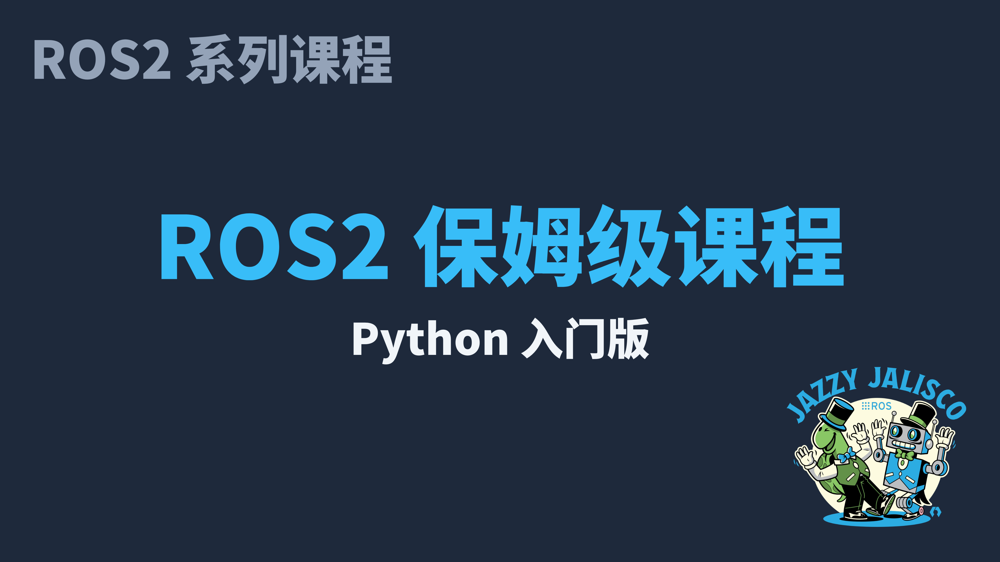

# ROS2 保姆级课程（Python 入门版)



> 版本基线：**Ubuntu 24.04 LTS（WSL2）· ROS2 Jazzy Jalisco · Python 3.12 · Gazebo Harmonic** 
> 上游大纲：[`Python入门版-大纲.md`](Python入门版-大纲.md)
> GitHub：https://github.com/lddzwxy/ros2_crash_course_for_beginner_python

---

## 文档合集

| 项目 | 路径 | 说明 |
| ------ | ---- | ---- |
| **分集细纲** | [`细纲/`](细纲/) | 10 个模块，51 集的目标/步骤/坑点/作业 |
| **配套讲义** | [`讲义/`](讲义/) | 每集一文：理论 + 手把手实操 |
| **教学代码** | [`code/`](code/) | 可编译的 `ros2_ws`，与讲义一一对应 |
| **接口契约** | [`code/CONTRACT.md`](code/CONTRACT.md) | `/cmd_vel` `/odom` `/scan` 与 TF 树 |

---

## 模块索引

| 模块 | 细纲 | 讲义目录 | 代码包 |
| ---- | :--: | :------: | ------ |
| 0 开机就绪 | [细纲](细纲/模块0-开机就绪.md) | [讲义](讲义/模块0-开机就绪/) | `m0_setup/` |
| 1 ROS2 初印象 | [细纲](细纲/模块1-ROS2初印象.md) | [讲义](讲义/模块1-ROS2初印象/) | `my_first_pkg` |
| 2 话题通信 | [细纲](细纲/模块2-话题通信Topic.md) | [讲义](讲义/模块2-话题通信/) | `my_topic_demo` |
| 3 服务与动作 | [细纲](细纲/模块3-服务动作与自定义接口.md) | [讲义](讲义/模块3-服务与动作/) | `my_interfaces` `my_service_demo` `my_action_demo` |
| 4 参数与 Launch | [细纲](细纲/模块4-参数Launch与工程化.md) | [讲义](讲义/模块4-参数与Launch/) | `my_bringup` |
| 5 可视化与调试 | [细纲](细纲/模块5-可视化与调试.md) | [讲义](讲义/模块5-可视化与调试/) | 复用 M2/M4 |
| 6 TF 与 URDF | [细纲](细纲/模块6-TF2与URDF.md) | [讲义](讲义/模块6-TF与URDF/) | `my_car_description` |
| 7 Gazebo 仿真 | [细纲](细纲/模块7-Gazebo仿真.md) | [讲义](讲义/模块7-Gazebo仿真/) | `my_car_gazebo` |
| 8 送货项目 | [细纲](细纲/模块8-综合项目送货.md) | [讲义](讲义/模块8-送货项目/) | `my_delivery` |
| 9 体验与路线 | [细纲](细纲/模块9-体验与路线图.md) | [讲义](讲义/模块9-体验与路线图/) | — |

---

## 快速开始

```bash
# 1. 准备 WSL2 + Ubuntu 24.04（见模块 0）
# 2. 安装 ROS2 Jazzy（见模块 1）
# 3. 把 code/ 拷到 ~/ros2_ws/src 同级结构
cd ~/ros2_ws
colcon build --symlink-install
source /opt/ros/jazzy/setup.bash
source ~/ros2_ws/install/setup.bash
# 4. 跑第一个节点
ros2 run my_first_pkg hello_node
```

---

## 教学原则（大纲）

- 先看见效果，再讲原理（每集 30s 演示）
- 生活化比喻：Topic=广播 · Service=打电话 · Action=点外卖 · TF=图例
- 踩坑前置：每集"常见坑"贴报错原文
- 预期可见：每步写明"跑完应看到什么"
- 版本钉死：全文只用 Jazzy / 24.04 / Python 3.12

---

*教材包 v1.0 · 与 CONTRACT.md 对齐*

