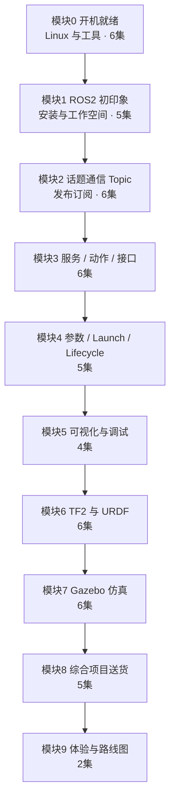

# 0.1 课程导学：学完你能做出什么

> 模块 0 第 1 集 
> 前置：无。一台 Windows 10/11 电脑即可。

---

## 一、本集目标

建立预期：知道 **学完后你能做出什么**、要准备什么、版本锁死在哪。

本集不敲命令，先把地图看明白，再动手。

---

## 二、效果演示

播放一段 30 秒最终项目录屏：

- Gazebo Harmonic 仿真世界里有一辆差速小车；
- 你按键盘，小车立刻动起来，绕过障碍物；
- 给一个目标点，小车自动开过去"送货"；
- RViz2 同步显示激光点云、坐标系、送货状态。

**最终现象**：一条命令启动全系统，车会动、能避障、能送达。

这就是整门课的终点。你现在不需要会做，只需要记住：**终点长这样**。

---

## 三、理论讲解

### 3.1 这门课到底在学什么？

机器人软件最大的麻烦不是"写算法"，而是：

> 摄像头、雷达、底盘、导航……一堆程序**怎么互相说话**？

**ROS2** 就是解决"说话"问题的开发框架。它给你三样东西：

| 它提供 | 生活化比喻 |
| ------ | ---------- |
| **通信机制**（Topic / Service / Action） | 广播、打电话、点外卖 |
| **工具链**（CLI、录包、可视化、调试） | 螺丝刀、万用表、示波器 |
| **生态**（驱动、导航、仿真插件） | 现成零件库 |

它**不是**装完就有界面的软件，也**不是**实时操作系统。它是一套"让多个程序协同工作"的规矩和工具。

### 3.2 课程地图：10 个模块怎么串

```text
M0 开机就绪        → 装系统、会终端、会写 Python
M1 ROS2 初印象     → 装 Jazzy、跑通第一个节点
M2 话题通信 Topic  → 发布 / 订阅（机器人"神经"）
M3 服务与动作      → 一问一答、长时任务
M4 参数与 Launch   → 工程化、一键启动
M5 可视化与调试    → 出问题怎么查
M6 TF 与 URDF      → 坐标系、机器人模型
M7 Gazebo 仿真     → 小车在虚拟世界跑起来
M8 综合项目送货    → 把前面全部串起来
M9 体验与路线图    → 看见进阶方向
```

能力主线就一句：**环境 → 通信 → 工具 → 建模仿真 → 项目**。

### 3.3 版本卡（锁死）

| 项目 | 锁定值 | 为什么锁死 |
| ---- | ------ | ---------- |
| 操作系统 | **Ubuntu 24.04 LTS（Noble）** | 与 ROS2 Jazzy 官方对齐 |
| ROS | **ROS2 Jazzy Jalisco** | LTS，支持到 2029 |
| Python | **3.12**（系统自带） | Jazzy 默认版本 |
| 运行方式 | **WSL2**（Windows 里跑 Ubuntu） | 免装双系统，能弹 Linux 窗口 |

**版本不对，后面全白装**。

### 3.4 学习节奏建议

| 项 | 建议 |
| -- | ---- |
| 每周 | 8–10 集 |
| 总周期 | 约 6–8 周 |
| 单集 | 8–15 分钟（安装类不超过 20 分钟） |
| 总正片 | 约 12–16 小时 |
| 方法 | **每集跟做**，做完小作业再下一集 |

不要跳着看。模块 0 的终端手感，是后面所有内容的地基。

### 3.5 配套资料一览

| 资料 | 用途 |
| ---- | ---- |
| 讲义（本系列） | 逐步操作 + 预期输出 |
| 小作业 | 每集 5 分钟验收 |
| 常见坑表 | 报错原文 + 解法 |
| `code/` 配套代码 | 对照/复制到 `~/ros2_ws` |
| `CONTRACT.md` | 话题名、坐标系的约定，全系列不许改 |
| 版本卡 | 写进你的作业 README |

---

## 四、实操步骤（手把手）

本集是导学，**不需要开终端**。但请按下面顺序走一遍，建立"跟做感"。

### 步骤 0 · 准备好记录工具

打开一个笔记本（纸质或 Markdown 文件）。

**Markdown**：Obsidian 或者 VSCode + Markdown插件
课程资料: https://pan.baidu.com/s/10ZpIUqdCVfOiS6FxTh7RgA?pwd=ding

### 步骤 1 · 抄下版本卡

在笔记里写：`WSL2 + Ubuntu 24.04 LTS (Noble) + ROS2 Jazzy Jalisco + Python 3.12`。

### 步骤 2 · 对照课程地图，标出你的目标

把 10 个模块名读一遍，在你最感兴趣的模块旁打星。



**能力主线**：环境与终端 → 节点/话题 → 服务与动作 → 启动组织 → 调试 → 坐标与模型 → 仿真 → 综合项目 → 看见进阶。

### 步骤 3 · 自检：你的电脑能不能学？

| 问题 | 要求 |
| ---- | ---- |
| 系统 | Windows 10（21H2+）或 Windows 11 |
| 内存 | 建议 8 GB 以上（我们后面会给 WSL 限 4 GB） |
| 虚拟化 | BIOS 里开启（Intel VT-x / AMD-V） |
| 磁盘 | 预留 30 GB 以上 |
| 其他 | 一台能上网的电脑，不需要显卡 |

打开任务管理器 → 性能 → CPU，确认"虚拟化：已启用"。

**预期**：看到"虚拟化 已启用"。若没有，记下来，下一集进 BIOS 打开。

### 步骤 4 · 写三句话

笔记里写：

```text
1. 我学完想做出什么：________
2. 我电脑是什么系统：________
3. 我每周能投入几小时：________
```

---

## 五、关键概念详解

| 概念                  | 一句话       | 生活比喻     |
| ------------------- | --------- | -------- |
| **Node（节点）**        | 一个干活的小程序  | 一个工人     |
| **Topic（话题）**       | 持续广播数据    | 广播电台     |
| **Service（服务）**     | 一问一答      | 打电话订位    |
| **Action（动作）**      | 长时任务+进度反馈 | 点外卖看配送进度 |
| **Parameter（参数）**   | 节点的可调配置   | 遥控器上的旋钮  |
| **Package（包）**      | 最小交付单元    | 一盒零件     |
| **Workspace（工作空间）** | 所有包的家     | 你的工具车间   |

本集只建立直觉。**模块 1 起你会亲手摸到它们**。

记住路线：Node 说话靠 Topic / Service / Action，配置靠 Parameter，代码装在 Package 里，Package 住在 Workspace 里。

---

## 六、常见坑

| 报错 / 现象 | 原因 | 解法 |
| ----------- | ---- | ---- |
| "把 ROS2 当成装完就有界面的软件" | 它是开发框架，不是 IDE 或游戏 | 界面（RViz2、仿真）是工具，要单独跑 |
| "一上来想学导航/机械臂" | 基础没打就开始盖楼 | 按 M0→M8 顺序走 |
| "跟着旧教程装别的版本" | 网上教程版本混乱 | 只认 **24.04 + Jazzy + 3.12** |
| "以为 ROS2 = 实时操作系统" | 概念混淆 | ROS2 是通信框架；硬实时是另一回事 |
| 虚拟化显示"已禁用" | BIOS 未开 VT-x | 重启进 BIOS 打开，再回来 |

---

## 七、预期输出汇总

学完本集，你应该能：

1. 口头说出最终项目长什么样（小车 + 目标点 + 激光 + 送货）；
2. 默写版本卡：**Ubuntu 24.04 / ROS2 Jazzy / Python 3.12**；
3. 说出 5 个模块名及大致顺序；
4. 写下三句话小作业。

---

## 八、小作业（5 分钟）

写 3 句话，存在笔记里：

1. 我学完想做出什么；
2. 我电脑是什么系统（`winver` 看 Windows 版本）；
3. 我每周能投入几小时。

**加分**：把任务管理器里"虚拟化"状态截图保存，下一集安装要用。

---

## 九、下集预告

下集从零把 **Ubuntu 24.04** 装进你的 Windows——一条 `wsl --install` 命令，两个小眼睛窗口验证成功。
