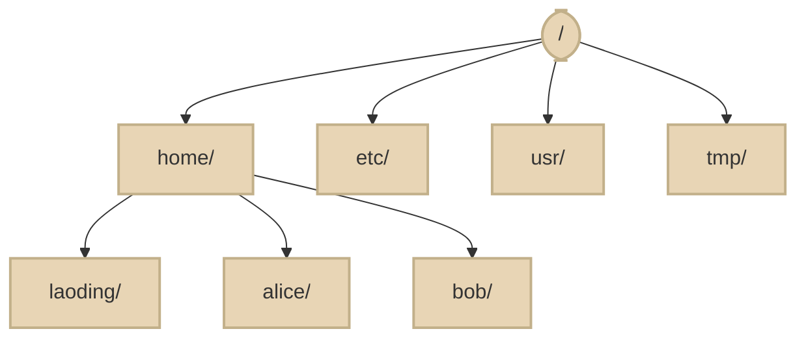

# 0.3 Linux 命令行急救包

> 模块 0 第 3 集 
> 前置：已完成 0.2，Ubuntu 终端能打开（提示符   `<用户名>@<电脑名>:~$`）。

---

## 一、本集目标

会用**目录、文件、权限、进程、管道、sudo** 完成日常操作，不再怕黑窗口。

---

## 二、效果演示

一个终端 30 秒连招：

```bash
mkdir -p ~/dev/practice && cd ~/dev/practice
echo "hello linux" > hello.txt
chmod +x hello.txt
ls -l hello.txt
sleep 300 &
ps aux | grep sleep
```

**最终现象**：建目录 → 写文件 → 加执行权限 → 看权限位 → 起后台进程 → 用管道查到它。

这一集练完，后面遇到任何目录/文件/进程操作你都有肌肉记忆。

---

## 三、理论讲解

### 3.1 你在哪里：`/` 根目录 与 `~` 家目录

Linux 目录像一棵**倒着长的树**：

```text
/                 ← 根目录（整棵树的起点）
├── home/
│   └── laoding/  ← 你的家目录，也写作 ~
├── etc/          ← 系统配置
├── usr/          ← 安装的软件
└── tmp/          ← 临时文件
```




| 写法 | 含义 |
| ---- | ---- |
| `/` | 根，整棵树的起点 |
| `~` | 你的家目录，如 `/home/laoding` |
| `~/dev/practice` | 家目录下的 dev/practice |
| `dev/practice` | **当前目录**下的 dev/practice（容易搞错） |

**口诀**：不确定自己在哪，先 `pwd`。

### 3.2 权限 `rwx`

每个文件有三组权限：属主 / 属组 / 其他人。

| 字符 | 含义 | 数字 |
| ---- | ---- | ---- |
| `r` | 可读 | 4 |
| `w` | 可写 | 2 |
| `x` | 可执行 | 1 |

`ls -l` 的第一列类似 `-rw-r--r--` 或 `-rwxr-xr-x`。`x` 就是"能当程序跑"。

### 3.3 管道 `|` 与重定向 `>` `>>`

| 符号 | 作用 | 比喻 |
| ---- | ---- | ---- |
| `|` | 把左边输出交给右边处理 | 流水线 |
| `>` | 覆盖写入文件 | 换了一页纸 |
| `>>` | 追加写入文件 | 在纸末尾接着写 |

例子：`ls -l | grep txt` = 列出文件，只留下名字带 txt 的。

### 3.4 进程：`ps` / `kill`

程序跑起来就是**进程**，有 PID（编号）。

| 命令 | 作用 |
| ---- | ---- |
| `ps aux` | 列出所有进程 |
| `ps aux | grep sleep` | 只找名字带 sleep 的 |
| `kill <PID>` | 温和地结束进程 |
| `top` / `htop` | 实时看资源占用 |

### 3.5 sudo：什么时候该用

`sudo` = 以管理员身份执行。**只在装软件、改系统配置时用**。

- 装包：`sudo apt install ...`
- 不要：`sudo ls`、`sudo cd`（没必要，还危险）

---

## 四、实操步骤（手把手）

### 步骤 0 · 打开终端

Windows：开始菜单 → **Ubuntu**； 
或 **Windows Terminal** → 下拉选 **Ubuntu**（`Ctrl+Shift+T` 新建标签页）。

**预期**：出现类似 `laoding@DING-PC:~$` 的提示符。

### 步骤 1 · 认位置

```bash
pwd
ls -la
cd ~
pwd
```

> 工作目录：任意（本步只看位置）。

**预期**：

- 第一个 `pwd` 显示类似 `/home/laoding`；
- `ls -la` 看到 `.bashrc`、`.profile` 等（点开头的是隐藏文件）；
- 第二个 `pwd` 仍是 `/home/laoding`。

### 步骤 2 · 建练习区

```bash
mkdir -p ~/dev/practice
cd ~/dev/practice
pwd
```

**预期**：`pwd` 显示 `/home/laoding/dev/practice`。

> `mkdir -p` 的好处：目录已存在也不报错，适合反复跟做。

### 步骤 3 · 写文件、看文件、追加

```bash
echo "hello linux" > hello.txt
cat hello.txt
nano hello.txt
# 写入 line2
# 编辑后保存退出：Ctrl+O → 回车确认 → Ctrl+X
cat hello.txt
```

**预期**：

```text
hello linux
line2
```

注意：`>` 覆盖，`>>` 追加。再做一次 `echo "x" > hello.txt`，内容会只剩 `x`。

### 步骤 4 · 看权限、加执行位

```bash
ls -l hello.txt
chmod +x hello.txt
ls -l hello.txt
```

**预期**：第一次类似 `-rw-r--r--`；第二次变成 `-rwxr-xr-x`，多了 `x`。

### 步骤 5 · 管道过滤

```bash
ls -l | grep txt
```

**预期**：只显示名字里带 `txt` 的行（我们的 `hello.txt`）。

再来一发：

```bash
ps aux | grep bash
```

**预期**：列出与 bash 相关的进程（至少有你当前终端）。

### 步骤 6 · 后台进程与 kill

```bash
sleep 300 &
ps aux | grep sleep
```

看输出里 `sleep` 那一行的 **PID**（第二列数字），然后：

```bash
kill <PID>
```

（把 `<PID>` 换成你看到的数字。）

再 `ps aux | grep sleep` 确认没了。

**预期**：进程被结束；`grep sleep` 只剩 grep 自己那一行（或没有）。

### 步骤 7 · 体会 sudo

```bash
sudo apt install -y tree
tree ~/dev
```

> 工作目录：任意。`sudo` 会提示输密码（盲打）。

**预期**：

```text
/home/laoding/dev
└── practice
    └── hello.txt
```

### 步骤 8 · 用 top 看一眼资源

```bash
top
```

**预期**：出现实时刷新的表格。按 `q` 退出。

---

## 五、关键 API / 命令详解

| 命令 | 作用 | 备注 |
| ---- | ---- | ---- |
| `pwd` | 打印当前工作目录 | 迷路时先敲 |
| `ls -la` | 列出全部文件（含隐藏） | `-l` 长格式，`-a` 含点文件 |
| `cd ~` | 回家目录 | `cd -` 回上一个目录 |
| `mkdir -p a/b` | 递归创建目录 | 已存在不报错 |
| `cat file` | 打印文件内容 | 小文件用 |
| `echo "x" > f` | 覆盖写入 | 会清掉原内容 |
| `echo "x" >> f` | 追加写入 | |
| `chmod +x f` | 加执行权限 | 也可 `chmod 755 f` |
| `grep key` | 过滤含 key 的行 | 常与管道合用 |
| `ps aux` | 查看进程 | 找 PID |
| `kill PID` | 结束进程 | 温和退出 |
| `sudo <cmd>` | 管理员执行 | 密码盲打 |
| `top` | 实时资源 | 按 `q` 退出 |
| `tree` | 树状列目录 | 需先安装 |

---

## 六、常见坑

| 报错 / 现象 | 原因 | 解法 |
| ----------- | ---- | ---- |
| `bash: cd: dev: No such file or directory` | 把 `dev` 当成绝对路径 | 写全 `~/dev`，或先 `pwd` 确认位置 |
| 误删家目录（`rm -rf ~` 一类） | `rm -rf` 太暴力 | 练习时**只删具体文件名**，删前先 `ls` |
| `sudo` 输密码没显示 | 正常盲打 | 输完回车即可 |
| `cat my file.txt` 报找不到 | 文件名有空格没加引号 | `cat "my file.txt"` |
| `kill` 报 `No such process` | PID 已经没了 / 看错列 | 再 `ps aux | grep sleep` 查 |
| `tree: command not found` | 没装 | `sudo apt install -y tree` |
| 权限 `Permission denied` | 没写权限 / 没执行位 | `chmod +x` 或用 `sudo`（仅系统文件） |

---

## 七、预期输出汇总

1. `~/dev/practice/` 存在，里面有 `hello.txt`（两行内容）；
2. `ls -l hello.txt` 能读出 `rwx`（有 `x`）；
3. `ps aux | grep sleep` 能查到后台进程，`kill` 后消失；
4. `tree ~/dev` 显示目录树。

---

## 八、小作业（5 分钟）

**不查笔记**，在 `~/dev/practice` 下：

1. 建 `day1/hello.txt`，写入两行任意内容；
2. 用 `cat` 读出来；
3. 用管道找出名字带 `txt` 的文件。

---

## 九、下集预告

会走路了。下集把 apt 软件源换成**国内镜像**，安装不再卡成 PPT。
